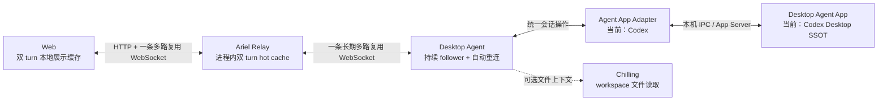

<p align="center">
  
</p>

<h1 align="center">Ariel</h1>

<p align="center">在浏览器中完成与桌面端 Agent App 的远程会话。</p>

## 20 秒了解 Ariel

https://github.com/user-attachments/assets/0f0abfb1-7ee0-4bbe-a6ee-a5a9d36728ee

## Ariel 是什么

Ariel 是一个面向桌面端 Agent App 的浏览器远程会话中继器。离开桌面端后，你仍可以在手机或其他浏览器中打开原会话、查看实时输出、继续发送消息、停止任务、处理审批与补充问题，也可以管理排队输入或在指定项目中新建会话。

它优先显示 Relay 和浏览器中已经安全缓存的最近两个 turn，再在后台接收增量更新。短暂断网、浏览器切到后台或 Desktop Agent 重连时，已显示的内容不会被整页 loading 替换；登录失效也在原页面恢复，保留正文和草稿，等最新状态确认后继续操作。

## 主要能力

- **远程继续原会话**：查看最近内容与实时输出，发送文字或图片，停止任务，处理 command／file approval 和结构化用户输入。
- **会话管理与模型选择**：按项目浏览、查看 unread、重命名、置顶和归档，每个会话保留独立草稿；模型入口与附件、发送按钮同排，图标显示推理强度和速度，设置从下一轮生效，不打断当前任务。
- **增量历史与稳定恢复**：首屏最近两个 turn，历史每次最多补三个；普通 streaming 正文默认每 5 秒合并刷新，开始、完成和交互即时更新。切换会话、应用和重连优先复用已有内容；Codex 自动重试用灰色状态提示，恢复后消除，真正失败显示红色原文。
- **排队输入**：会话运行期间可以继续准备后续消息，并调整、引导或删除排队内容。
- **文件上下文**：启用 Chilling 后，可以查看每个 turn 修改的文件、原文与 diff，也可以浏览当前 workspace 文件树、打开文档引用、选中片段并引用到当前会话。
- **移动端交互**：紧凑顶部仅保留右对齐的文件入口，当前权限信息位于输入框加号旁；针对手机 viewport、软键盘、长按菜单、滚动阅读和后台恢复做了独立适配。

Ariel 不复制会话，不接管工作目录，也不建立另一套聊天记录。Codex Desktop 始终是会话、turn、权限和执行状态的唯一来源。

## 架构



- **Web** 提供手机与桌面浏览器界面，并在用户本地保存有界的双 turn 展示缓存和分会话草稿。
- **Relay** 负责认证、连接管理、消息路由，以及每个 hot 会话最近两个 turn 的进程内只读 cache；cache 不写入磁盘。
- **Desktop Agent** 在桌面设备上长期跟随 hot 会话。Relay transport 断开时，它会独立重连，不销毁 Codex Service 或已有 follower。
- **Agent App Adapter** 把统一会话操作转换为目标桌面应用的本机能力；当前实现是 Codex Adapter，并在每次 mutation 前现场核对当前 owner 和权限。
- **Chilling** 是可选的本地文件上下文 backend；文件原文、diff 和 workspace tree 不由 Relay 持久化。

读链路优先从 Relay hot cache 返回，再由 Desktop Agent 的持续 follower 推送增量；写链路仍必须到达 Desktop Agent，并由 Codex 当前 owner 现场确认。Relay cache 和浏览器 cache 都不能授权发送、停止、审批或回答，也不会自动重放结果不确定的操作。详细边界见[架构总览](docs/architecture/overview.md)和[Agent Transport 与 Cache 恢复规格](docs/specs/0107-resilient-agent-transport-and-cache-recovery.md)。

## 当前支持范围

| 维度 | 当前实现 |
| --- | --- |
| 桌面平台 | macOS |
| Agent App | Codex Desktop |
| 本机接入 | Codex Desktop 私有 IPC 与内置 Codex App Server |
| 会话同步 | Agent／Relay 与 Web／Relay 各使用一条多路复用 WebSocket；最近两个 turn 增量 cache |
| 文件能力 | 可选 Chilling backend：turn 文件变更、原文、diff、文档引用与 workspace 浏览 |
| 部署方式 | 单用户；可信局域网可用 6 位 PIN，公网可用原生 Passkey；Relay + Web 可用 Docker、ECS 单机脚本或 Kubernetes 交付 |

这是当前实现矩阵，不是 Ariel 的产品边界。其他桌面平台和 Agent App 尚未适配，也不能由现有测试推断为可用。

## 快速开始（当前 Codex Adapter）

准备一台正在运行 Codex Desktop 的 Mac，并安装 Go 1.26+、Node.js 和 npm。手机与 Mac 需要连接同一个可信局域网。

```sh
git clone https://github.com/wu8685/Ariel.git
cd Ariel
./scripts/ariel.sh up local \
  --listen '<HOST-LAN-IP>:8080' \
  --device-id 'my-desktop' \
  --device-name '我的桌面设备'
```

脚本会构建 Web、Relay 和 Desktop Agent，并在成功后输出手机可访问的地址。查看运行状态和六位连接码：

```sh
./scripts/ariel.sh status
./scripts/ariel.sh show-pin
```

## 基本使用

在手机打开脚本输出的地址，输入六位连接码后选择会话；换网时运行 `./scripts/ariel.sh restart-local`，结束时运行 `./scripts/ariel.sh stop`。

## 安全边界

Ariel 当前采用单用户模型：登录者可操作全部会话，不提供 RBAC。可信局域网可以继续使用默认 6 位 PIN；公网部署必须使用 HTTPS/WSS，并把 Web 认证切换为 Passkey。Passkey 凭据保存在 Relay 的私有 JSON 文件中，会话使用加密 `HttpOnly` Cookie，因此不需要数据库或外部 OIDC。Agent 跨公网连接 Relay 时仍使用独立高熵 token。

远程操作沿用目标 Agent App 的当前权限；页面出现高权限提示时，请先确认你接受该权限范围。当前 Codex Adapter 依赖 Desktop 私有 IPC，版本变化可能造成兼容性问题；不兼容操作会显式失败，不会被当作成功或自动重试。

## 深入阅读

- [当前 Codex Adapter 的安装、配置与故障排查](docs/operations/agent-install.md)
- [用 Docker 部署 Relay + Web](docs/operations/container-deployment.md)
- [公网 Passkey 部署与安全边界](docs/operations/public-passkey-deployment.md)
- [系统架构总览与 Adapter 边界](docs/architecture/overview.md)
- [当前 Codex Adapter 的兼容性与实测边界](docs/compatibility/2026-10-03-m0.md)
- [功能规格索引](docs/specs/README.md)
