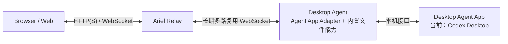

<p align="center">
  
</p>

<h1 align="center">Ariel</h1>

<p align="center">在浏览器中完成与桌面端 Agent App 的远程会话。</p>

[项目文档](docs/README.md) · [20 秒演示](docs/guide/features.md#演示)

## 解决什么问题

离开电脑后，Agent 仍在工作，但你可能需要查看进展、补充指令或处理审批。Ariel 让你在手机或其他浏览器中继续桌面端的原会话，不必搬运聊天记录或远程控制整个桌面。

当前支持 macOS 上的 Codex Desktop；其他桌面平台和 Agent App 尚未适配。

## 功能

- **继续对话**：查看实时输出，发送文字和图片，停止任务，处理审批与补充问题。
- **查看异步问题**：在会话原位置查看题目、选项和原生已回答内容，可在本页跳过或重新展开，不阻塞主输入框；当前异步提交仍需回 Codex 操作。
- **管理会话**：搜索、新建、重命名、置顶、归档，查看未读提示并保留分会话草稿。
- **调整执行**：选择模型、推理强度和速度，管理排队消息，编辑并重发最后一条已停止的纯文本输入。
- **阅读与对照**：用多个 Tab 查看原文、Markdown 和 Diff，支持公式、代码和按需图片；电脑宽屏可同时显示会话菜单、文件与当前对话，手机保留全屏阅读／最小化。刷新后恢复阅读位置，选中片段可引用到会话。
- **稳定接续**：优先展示缓存，增量更新；切换应用、短暂断网或登录恢复时保留已有内容。

操作是否可用取决于设备能力、功能开关和兼容性验证，详见[功能与使用指南](docs/guide/features.md)。

## 架构



Web 提供交互，Relay 负责认证、路由和内存缓存，Desktop Agent 连接桌面应用并提供文件能力；原会话与执行状态仍由 Agent App 管理。基础功能不依赖 Chilling，它仅是可选看板扩展。详见[架构与数据边界](docs/architecture/overview.md)。

## 安装

准备一台运行 Codex Desktop 的 Mac，安装 Go 1.26+ 和 Node.js 22.12+（含 npm）。以下为同一可信局域网的最小安装：

```sh
git clone https://github.com/wu8685/Ariel.git
cd Ariel
./scripts/ariel.sh up local \
  --listen '<HOST-LAN-IP>:8080' \
  --device-id 'my-desktop' \
  --device-name '我的桌面设备'
./scripts/ariel.sh show-pin
```

把 `<HOST-LAN-IP>` 替换为 Mac 的局域网地址；手机打开脚本输出的网址，输入连接码后选择会话。文件能力默认关闭，启用方法及日常命令见[安装与配置](docs/operations/agent-install.md)。

公网请使用 HTTPS／WSS＋Passkey，不能暴露 PIN 服务；当前为单用户模型，登录者可操作全部会话。远程部署见[Docker](docs/operations/container-deployment.md)／[ECS](docs/operations/ecs-single-node-deployment.md)，完整入口见[项目文档](docs/README.md)。
