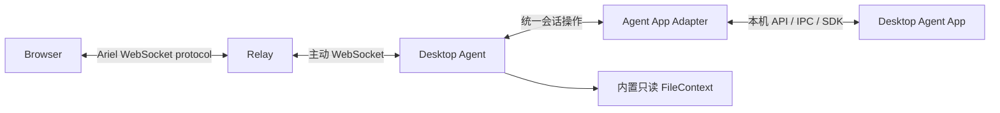

# Ariel 架构总览

Ariel 是浏览器与桌面端 Agent App 之间的远程会话中继器。它让用户从手机或其他浏览器继续桌面端的原会话，同时保留原有执行环境、权限和状态归属。

[文档导航](../README.md) · [功能使用](../guide/features.md) · [安装配置](../operations/agent-install.md)

这一定义不绑定特定桌面操作系统或 Agent App。当前仓库只实现并验证了 macOS 上的 Codex Desktop Adapter；其他组合仍属于后续适配范围。

## 组件

| 组件 | 职责 | 不负责 |
| --- | --- | --- |
| Browser | 展示会话、收集用户的显式操作 | 持有桌面凭据、直接调用 Agent App |
| Relay | 认证、路由、消息转发、有界只读 hot cache 和容量限制 | 持久保存会话正文、直接读桌面文件、代替 Agent App 执行 |
| Desktop Agent | 从桌面设备主动连接 Relay，执行通用请求，提供受限文件上下文 | 成为新的会话 SSOT、通用 filesystem／URL 代理 |
| 内置 FileContext | 校验 workspace 与原生来源，按需读取文件／目录／图片并复验选区 | 编辑文件、建立 native mutation owner、连接 Chilling |
| Agent App Adapter | 将通用会话语义映射为具体产品能力 | 把未验证能力伪装成已支持 |
| Agent App | 持有原会话、执行状态、权限和工作环境 | 保存 Ariel 的浏览器连接状态 |

## 不变量

1. 目标 Agent App 是会话与执行状态的唯一事实来源（SSOT）。
2. Relay 和 Desktop Agent 使用有界内存，不建立平行会话数据库或离线写队列。
3. 发送、停止、审批、补充回答和队列修改都必须由用户显式触发。
4. 写操作结果不确定时不自动重放；Ariel 重新读取 Agent App 的权威状态。
5. Web 与 Relay 使用 Ariel 自有协议，不接触某个 Agent App 的私有方法名。

Codex 会话与文件代理不依赖 Chilling。文件来源证明经已有只读 App Server endpoint 获取：thread metadata 不包含历史，items 只按指定 turn 分页；当前文件通过受控根目录下的 no-follow 文件句柄有界读取。所有发送仍由既有 owner 受理。任务库／MySQL／scheduler 属于独立可选任务业务，不因文件迁移进入 Ariel；完整范围和兼容细节见 [0119](../specs/0119-self-contained-desktop-file-context.md)。

本地 Markdown 图片与正文分离，按需分块流经既有 WebSocket；Relay 不将图片、目录或文件正文放入会话 hot cache。原版／阅读切换在 Web 本地完成，不重新订阅会话；图片资源 lease、浏览器 Blob 和缓存均有大小与生命周期限制。新图片方法通过 response.data 可选扩展协商，不向旧严格 hello／device 结构无条件添加字段。

## 连接与数据流

Web 与 Relay 使用一条多路复用 WebSocket，每台 Desktop Agent 与 Relay 也使用一条长期多路复用 WebSocket；不是每个会话建立一条独立连接。多个 Web 关注同一设备／会话时，共享 Agent 的 hot 会话跟随与 Relay cache，不创建 per-Web native follower。

1. **持续更新**：Desktop Agent 跟随 Codex 会话变化，向 Relay 推送双 turn snapshot／增量；Relay 更新自己的进程内存 cache，并通知 Web watcher。普通 streaming 默认按 5 秒合并，关键状态即时推送。
2. **打开会话**：Web 优先显示浏览器已有内容，再读／watch Relay cache；冷缓存或过期状态需要 Agent 准备、校验和更新。历史每次最多补三个 turn；文件、图片、工具详情仍按需走 Agent，不把所有读取都改成 cache-only。
3. **用户操作**：Web → Relay → Desktop Agent → Codex 当前 owner；执行结果经既有持续跟随链路返回。cache 不能证明 mutation 已执行，unknown 不自动重放。

Agent transport 断线后独立重连，保留可继续使用的 Codex Service 与 follower；重新连接时按 Relay 关注集合恢复并核对会话，不要求 Web 刷新才能接收终态。具体恢复条件见 [0107](../specs/0107-resilient-agent-transport-and-cache-recovery.md)。

异步问题复用相同 follower 和 WebSocket，以显式协商的 `asyncQuestions` sidecar 绑定相同 cache stream／seq，与双 turn 正文原子替换。单窗口最多 64 题／64 KiB，实际字节计入 Relay 内存预算；正文仍按 5 秒合并，问题状态变化即时推送。旧 Web 不接收新字段，旧 Agent 不接收未经协商的参数；Web 按 turn 仅保留有界内存视图，不建立问题数据库。当前 native 异步提交门禁关闭，读取支持不代表写入受支持，见 [0126](../specs/0126-asynchronous-question-cards.md)。

## 缓存与资源边界

| 层 | 内容与用途 | 生命周期与约束 |
| --- | --- | --- |
| Web | 最近两个 turn 的展示缓存、已拉取历史、分会话草稿与本地已读水位 | 浏览器本地、有界；TTL／容量／身份变化可使缓存失效，不是原会话 SSOT |
| Relay | hot 会话最近两个 turn 的只读 cache | 仅进程内存，不写磁盘、数据库、volume、内容日志或 crash dump；重启丢失，Agent 断线标 stale |
| Desktop Agent | follower 当前视图、按需文件与短期图片 lease | 有界、可重建；文件读取按 workspace 与原生来源重新授权，不形成会话数据库 |
| Codex Desktop | 原会话、执行和权限状态 | 唯一权威来源，Ariel 不建立第二套会话存储 |

Relay 默认 cache soft budget 512 MiB，`GOMEMLIMIT=768MiB`，容器 hard limit 1 GiB；不设置固定会话数上限。压力下先淘汰无 watcher 的 LRU 或返回 capacity error，不能把 OOM 当作正常淘汰机制。文件正文、Diff、目录和 Markdown 图片不进入双 turn hot cache；具体文件与资源限额见[文件配置](../operations/file-context.md)。

文件 Tab 的刷新恢复使用当前浏览器标签页的 `sessionStorage`，仅存来源 descriptor、模式、滚动、版本指纹和选区 offsets，1 MiB／7 天有界；不保存文件原文、Diff、引用片段、图片或凭据。恢复先核对认证、设备 epoch 和 capability，再沿既有 Agent 只读链路按需读取激活文件；正文与 Diff 仍共用 8 MiB／10 项内存 LRU。该记录不是来源授权或 mutation receipt，不新增连接、后台轮询或 Chilling 依赖，详见 [0123](../specs/0123-file-reading-refresh-restore.md)。

## 认证边界

- Browser → Relay：可信局域网可选择 6 位 PIN；公网使用原生 Passkey 和加密 `HttpOnly` Cookie。两种模式互斥，Passkey 模式不接受 PIN、旧 Web Session 或二维码配对凭据降级。
- Desktop Agent → Relay：始终使用独立高熵 Agent token；跨公网时必须使用 WSS。
- Desktop Agent → 本机 Agent App：由具体 Adapter 使用目标产品的本机集成能力，不复用 Relay 登录。

Passkey 公钥记录保存在小型私有 JSON 文件中，属于认证配置，不是会话数据库。Relay 不持久化会话正文或离线任务，Web Session 使用加密 Cookie；需要全局注销浏览器时轮换 Cookie key。完整部署边界见[公网 Passkey 部署](../operations/public-passkey-deployment.md)。

## Agent App Adapter 边界

一个 Adapter 可以按目标产品能力提供以下子集：

- 会话列表、搜索、读取与实时订阅；
- 新建会话、发送、停止与运行状态；
- 审批、结构化补充问题和后续输入队列；
- 项目目录、置顶状态、附件和工具活动；
- 版本检测、能力声明与明确的兼容错误。

能力必须在握手时声明。Web 只展示当前 Adapter 明确支持的操作；缺失或未验证的能力保持不可用，不能从另一个 Adapter 的行为类推。

## 当前支持矩阵

| 桌面平台 | Agent App | Adapter 状态 | 证据 |
| --- | --- | --- | --- |
| macOS | Codex Desktop | 已实现；按最低版本门禁，较高版本运行期验证 | [兼容性报告](../compatibility/2026-10-03-m0.md) |
| Windows / Linux | 尚无 | 未适配 | 无 |
| 其他 Agent App | 尚无 | 未适配 | 无 |

这张表描述当前发行版，不是 Ariel 的产品边界。未列为“已实现”的组合均不可视为受支持。

## 现有耦合与演进方向

provider-neutral 的分层目标已经明确，但通用 Adapter 抽象尚未完成。当前代码仍包含 `internal/codex`、协议字段 `codexReady`、Codex deep link、版本探针和产品特定交互映射。

接入第二个 Agent App 或桌面平台前，需要先：

1. 提取稳定的 Adapter 接口和能力一致性测试；
2. 将产品特定就绪状态迁移为通用能力，同时保持 v1 协议兼容；
3. 把启动、版本检测和本机发现移动到各 Adapter；
4. 为新组合单独定义权限、失败语义、兼容矩阵和隔离 fixture；
5. 完成对应平台的真实浏览器与桌面端验收。

早期 Codex 专用决策与实验保留在 [`docs/specs/baseline/`](../specs/baseline/README.md)，作为首个 Adapter 的历史证据，不再承担 Ariel 的长期产品定义。
