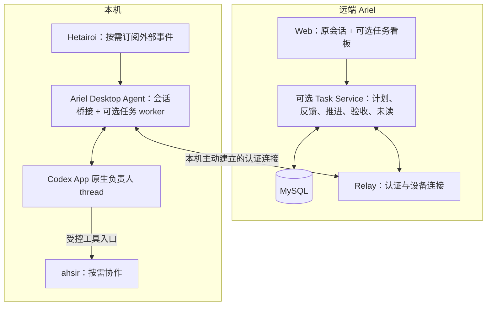

# 0088：可选任务看板、本机 Codex 负责人及双向反馈

- 状态：Superseded（2026-10-17：由 Ariel 0091／chilling 0001 的统一入口＋本地任务后端方案替代；未开始实现）。
- 当前归属：Ariel [0091](0091-chilling-task-board-and-background-routing.md) 负责统一 Web／云端接入与后台路由，chilling `docs/specs/0001-local-task-kanban.md` 负责本地任务后端。
- 最新决定：前端／云端代码统一归 Ariel，MySQL／scheduler 仍留本地 chilling；Ariel 将按新草案增加可选入口／gateway，但不恢复本文的云端数据库方案。本规格仅保留历史。

> 下文描述的是已被替代的“在 Ariel 内增量实现、任务服务部署远端”方案，不再作为实施依据。Ariel 0091 与 chilling 0001 分别定义新的接入／本地后端及独立开关，任务 MySQL 和调度仍在本地，不改变 Ariel 的无任务数据库运行方式。

- 关联：[架构总览](../architecture/overview.md)、[0031 原生后续输入队列](0031-codex-follow-up-queue.md)、[0069 精确送达核对](0069-confirmed-send-clears-composer.md)、[0076 首条 turn bootstrap](0076-local-draft-first-turn-bootstrap.md)、[0077 浏览器本地未读](0077-web-local-thread-unread.md)、[0086 controller 暖保留](0086-progressive-open-frame-hint-and-warm-controller.md)。

## 1. 用户结果与范围

用户在看板中组织任务，在卡片内补充要求、查看降噪后的进展、回答问题和验收结果。每项已启动任务由本机 Codex 的一个真实 thread 负责；用户可在 Codex App 中查看并继续同一对话。负责 Codex 可以自行工作，也可以经明确提供的工具调用本机 ahsir，使用 A2A／relay／roundtable 协作。

任务模块与原会话模块共用 Ariel 的产品入口、身份与设备连接基础设施；任务状态、可靠投递和后台同步使用独立模块。Hetairoi 按需提供外部事件，不是看板与 Codex 之间的必经代理。

第一版按以下已讨论规则推进：

1. 新建任务进入待办；用户点击“开始”后，才授权在该任务目标、约束和当前原生权限范围内持续推进。
2. Agent 提交成果后进入待验收，用户确认后进入已完成；单个 Codex turn 成功不等于业务任务完成。
3. MySQL 保存任务、用户主动提交的反馈、必要进展和摘要；完整 native transcript、工具原文和本地附件保留本机，按需通过原会话查看。
4. 任务进展和反馈处理在后台持续运行，不依赖 Web 是否打开。

本规格不增加独立云端 LLM，不把 ahsir 的独立会话替代为主负责人，也不承诺下游 Agent 的模型或对话自动继承主 thread 的配置与 App 可见性。

## 2. 显式开关与无数据库模式

### 2.1 开关契约

1. Relay／Web 服务进程与本地 Desktop Agent 均支持同名布尔 flag `--enable-tasks`，默认值为 `false`；支持显式 `--enable-tasks=false`。服务端开关控制数据库与任务服务，本机开关控制后台执行与同步。
2. 本地一键入口 `scripts/ariel.sh up local ... --enable-tasks` 将该选择传递给所启动的两端；`up agent ... --enable-tasks` 只开启本机任务能力。公网 Relay 由部署配置独立显式开启。
3. 若启动器保存开关，仅保存非敏感布尔值；旧配置缺失该字段视为关闭。`up` 复用此前显式保存的配置，`status` 展示开关和任务链路状态，不展示数据库凭据。
4. MySQL 连接配置使用服务端私有环境变量 `ARIEL_MYSQL_DSN`。配置 DSN 本身不能开启任务功能；不提供把密码放入命令行参数的入口。本机 Agent 不读取该 DSN、不连接远端数据库。
5. 任务能实际执行要求：服务端开启、任务服务 ready、本机显式开启、兼容性能力通过、设备在线。单侧开启不得隐式开启另一侧。
6. flag 是启动配置，第一版不做运行中热开关；两端通过能力与状态协商展示实际可用性。新增协议不得使旧版普通会话客户端失效。

### 2.2 默认关闭时

- 不解析或校验 MySQL DSN，不创建数据库连接池，不调用 Open／Ping，不运行 schema 检查或 migration。
- 不注册任务业务 API，不启动 task scheduler、任务投递、任务专用本地后台订阅或交付 journal；不连接 ahsir／Hetairoi 进行任务工作。
- Web 隐藏看板入口，不发任务查询和轮询；猜测任务路径不能绕过开关。若保留功能发现接口，只能返回 `enabled:false`，不能触及数据库。
- 不改变既有会话的原生队列、owner、权限、断线恢复、内存上限或请求重放行为。
- 缺少 DSN、DSN 内容无效或 MySQL 完全不可达时，关闭模式仍能启动并提供原有聊天功能。
- 不创建或迁移任何任务数据。编译产物可以包含数据库 driver，但运行环境无需安装或启动 MySQL。

### 2.3 开启后的异常与关闭行为

1. 显式开启但缺失或格式错误的 DSN，启动配置校验明确失败；错误不得回显 DSN、密码或认证信息。
2. DSN 合法但 MySQL 暂时不可达、schema 不兼容或运行中失联，任务模块进入不可用／降级状态；原有会话通道继续服务。任务读写返回明确错误，不回退到内存队列并伪装已保存。
3. 用户提交反馈仅在 MySQL 事务提交后显示“已记录”。事务失败保留输入草稿，不展示成功。
4. `/healthz` 继续表示原服务存活，不因任务数据库不可达而反复重启健康的聊天服务；任务 ready 状态另行暴露。数据库检查采用有界超时和退避，不能阻塞普通会话请求。
5. 重新以关闭模式启动会停止新增任务派发并保留已有 MySQL 数据；不得删除任务、自动取消本机正在执行的 turn，或把未确认操作标记失败／成功。
6. 再次开启先核对已有执行和持久化游标，再恢复派发。schema 变更使用独立、受版本管理的 migration，不在普通启动时执行破坏性 DDL。
7. 数据库故障时停止派发新指令。command 已送达本机不等于 native 已受理：尚未受理的指令保留待核对状态，不在失去有效任务状态／授权核验时开始新 turn；已被 native 精确受理的执行不因数据库断线被误取消。

## 3. 部署与模块边界

| 状态 | 权威归属 |
| --- | --- |
| Task、目标、约束、验收条件、反馈、可见进展、用户已读水位 | Task Service／MySQL |
| 任务指令、投递状态、执行关联、后台同步游标 | Task Service；必要的本机交付元数据由任务 worker 管理 |
| native thread／turn／item、正文、原生队列、当前权限与实际执行状态 | 本机 Codex |
| 下游 Agent／context／Room、A2A 调用和完整轨迹 | ahsir |
| 外部 source／handler／去重状态 | Hetairoi |
| 浏览器连接、临时路由和原会话订阅 | 现有 Relay／Desktop Agent |

此前“无数据库、无离线 mutation queue、写操作逐次显式触发”的约束继续适用于原会话域。任务域仅在本规格批准且 flag 开启后引入 TaskStore、持久化任务指令和任务级持续委托；不能借此自动重放原聊天操作或复制完整会话库。本文批准前不改写现有架构／AGENTS 中的生效约定。

## 4. 输入、输出和身份

### 输入

- 建卡：标题、目标、必要背景、约束、验收条件、目标设备和本机工作目录；首版不要求任务必须对应 Git 仓库。
- 用户操作：开始、提交反馈、回答待决问题、暂停／继续、确认完成、显式重新打开已完成任务。
- 本机事实：原生会话的可核验消息身份、turn 状态、交付物引用、结构化阶段事实和待决事项。
- 可选外部输入：经受信配置映射到任务的 Hetairoi 事件、依赖变化、ahsir 子任务结果。
- 定时输入：仅针对已开始任务的检查与汇报时机。

### 输出

- 看板卡片与任务详情：状态、最新简短进展、负责人、最近确认时间、未读、待决事项和交付物。
- 反馈记录与独立投递状态；不得把“服务器已存储”标成“Codex 已受理”。
- 进入原 Codex thread 的任务指令与反馈；需要时可从任务详情打开该会话。
- 明确的 waiting reason、失败或 outcome unknown，以及可用的继续／核对操作。

### 稳定标识

至少区分 `task_id`、`task_version`、`event_id`／任务内 `seq`、`feedback_id`、`command_id`、`attempt_id`、`device_id`、`native_thread_id`、`native_turn_id`、`client_message_id` 和下游执行引用。任务 ID 不等同于 thread ID；同一任务后续反馈和重试默认延续同一个 native thread。

未启动任务尚无 native thread。开始与反馈使用稳定的业务 command ID；RPC request ID、临时 WebSocket connection ID、Agent epoch 不能取代业务幂等身份。设备标识和本机路径由用户或现有设备配置选择，不硬编码到仓库。

## 5. 看板、状态与操作

默认列：**待办／进行中／等待中／待验收／已完成**。

| 行为或事实 | 业务结果 |
| --- | --- |
| 新建任务、尚未点击开始 | 待办；记录反馈但不执行 |
| 用户点击开始 | 持久化启动意图；设备可执行后进入进行中 |
| 本机离线、任务能力未开启、等待依赖／权限／用户决策 | 等待中，保留明确 reason 与最近已确认执行状态 |
| 只有连接中断，实际执行可能继续 | 标记状态待同步，不因此判定执行失败或重复启动 |
| Agent 提交交付物和验收依据 | 待验收；失败的 turn 不能按成功交付处理 |
| 用户确认完成 | 已完成 |
| 待验收时提交修改反馈 | 延续原 thread；需要执行时回到进行中或等待中 |
| 已完成后输入反馈 | 可留档；必须显式“重新打开并提交”才恢复执行 |

卡片移动通过业务操作驱动；不能仅拖到“已完成”就绕过用户验收，或拖到“进行中”就绕过开始授权。等待原因、未读、需用户处理、原生运行状态是独立字段，不用一个列值替代所有状态。

暂停首先停止后续自动派发；是否中断当前原生 turn 使用独立、精确的停止操作与确认结果。关闭页面、关闭任务 flag 或暂时断网均不等于用户取消当前工作。

## 6. 本机 Codex 负责人

1. 主责任单元绑定 `task_id + device_id + native_thread_id`。创建链路复用 0076 的已验证基础，但不能仅启动一个孤立 CLI 就声称 Codex App 可见。
2. 使用本机 Codex 的官方认证和账户可用官方模型；模型 ID 从本机实际模型目录选择，不硬编码。不得因故障静默切换第三方 provider，也不把登录凭据上传远端。
3. 当前配置继承不等同于已经验证为官方 provider；无法核验时显示待配置／待验证，不能冒充满足约束。用户在 App 中变更模型后的行为也需要 capability 验证。
4. 任务角色契约至少包含：目标、约束、验收条件、按需委派、证据要求、汇报格式和等待用户的条件。逐 thread system／developer instruction 注入尚未证实；角色契约如何落到 native 输入／配置须经兼容性验证，不覆盖用户全局配置。
5. 用户在 Codex App 中的相关输入和输出同样纳入该任务事实；后台提交前检查 fresh owner、当前 turn 与待处理交互。App 手工输入优先，旧任务版本不能覆盖新的目标。
6. 单个 native thread 保持唯一 mutation owner。Ariel 本地锁不能被描述为已解决 App UI 的跨进程并发；`TURN_BUSY` 延后，结果未知先核对，不无条件抢占或重发。
7. 通过受控 CLI／工具／MCP 接口向主 thread 提供 ahsir 能力。主 thread 的 App 可见性不意味着下游所有对话也在 App 可见；必要结果汇回主 thread 和任务进展。没有该工具能力时允许负责人自行工作，不能伪造已调用专家。

## 7. 任务消息、订阅与唤醒

每任务有持久事件序列与逻辑 inbox，不要求每任务建立一条网络连接、物理 MQ 或常驻 Agent 进程。任务内输入有序处理，不同任务可在配置上限内并行。

| 消息 | 是否唤醒负责人 |
| --- | --- |
| 已开始任务的新用户指令、反馈、待决问题回答 | 是 |
| 映射后的外部事实、依赖完成、下游执行结果 | 按当前任务状态和目标投递 |
| 定时检查 | 仅在任务已授权、确有待检查工作且未暂停时 |
| Agent 进展、摘要、看板展示更新 | 否；用于展示和未读 |
| 标题、排序、已读操作、心跳 | 否 |

每事件保留来源、actor、target 和因果关联；Agent 自己写回的进展不能再次成为它的新任务。下游回执投给对应父执行，不广播唤醒所有参与者。

负责人每轮固定输入水位和任务版本；执行中新增反馈进入下一批，不丢弃、不并发开启第二个同 thread turn。结果记录它实际处理的反馈范围；取消、暂停和目标变更不得被迟到的旧结果覆盖。

## 8. 反馈闭环与可靠投递

任务详情提供反馈输入框。提交的反馈是有身份、可追踪的任务消息，同时进入负责 Codex 的后续输入，不仅作为备注保存。

1. MySQL 在同一事务中保存反馈／任务事件与待投递 command（outbox），事务提交后回“已记录”。相同客户端提交键重试只产生同一条反馈。
2. 本地 worker 接收 command，记录交付元数据，通过 native owner 提交。忙时等待或使用已核验的原生队列；同一 command 的投递重试不能生成新的逻辑反馈。
3. 用户可辨认“待投递／已提交 Codex／已回应”；处理中另可显示等待设备、排队、投递失败或结果待核对。原生受理须有 exact thread／turn／client-message 或 queue 身份证据。
4. “已回应”要求负责人输出与该反馈明确关联；不能仅凭后续任意 assistant 消息、活跃状态或相同正文标记已回应。批量处理多条反馈时记录覆盖的 feedback IDs。
5. 原生消息和回执丢失时进入 unknown，先按稳定身份读取权威状态。找不到记录不自动证明没有执行；无法排除执行时保留核对状态，允许用户明确关联已有会话，不盲目补建。
6. 传输按至少一次交付设计，MySQL 事务不覆盖 Codex 原生执行；不宣称跨系统 exactly-once。首 thread 创建与 command 落账之间的崩溃窗口必须有专门用例。
7. 本机断网但已受理的工作可以继续；结果经本机任务交付元数据和 native snapshot 恢复后补传。关闭页面不取消反馈、不丢 outbox。
8. 任务关闭或暂停时仍允许保存反馈；暂停不因反馈自动恢复，已完成任务的执行遵循第 5 节。

## 9. 后台同步与进展降噪

1. 开启任务功能时，由独立于 Web 订阅生命周期的 task worker 持有必要跟踪。不能把 0086 的 90 秒暖保留当作无人打开看板时的持续任务监控。
2. 以 exact native thread／turn／item 身份、持久消费水位和 fresh snapshot 核对变化。重连先恢复事实；旧 epoch、旧 owner 和迟到 stream 的内容不能覆盖新状态。
3. 已启动任务的有效进展自动回写：本机 Codex 阶段事实 → 降噪后的结构化进展 → MySQL task message → 看板更新。用户直接在 App 继续对话产生的相关进展同样适用。
4. 默认每 10 分钟检查一次可汇报变化，可配置；成果、阻塞、需要用户决策和交付立即发布。无新事实不刷重复回复；只有心跳时更新最近确认时间，不伪造完成百分比。
5. 调度器负责定时和恢复，prompt 负责内容选择与表达。长 turn 期间汇报可使用已记录事实，不强行向忙碌的负责人插入一轮“汇报”请求。
6. 首版不增加云端摘要模型。需要模型归纳时使用明确配置的本机官方 Codex 路径，并与负责人 mutation 串行／隔离；只有无副作用的已记录事实可以供汇报流程读取。
7. 每份进展记录来源引用、覆盖水位、已验证成果、阻塞／待决事项和下一步；同一覆盖范围不重复发布。目标、约束、验收条件、未决反馈与待批准事项保持结构化，不被滚动摘要删除。
8. 完整工具流水和重复尝试不进入看板讨论流，可从本地执行详情按需查看。无法取得新事实时显示“状态待同步”或最近确认事实，不把摘要推断当作原生执行状态。

## 10. MySQL 数据契约

下列为逻辑模型，具体 migration 和 Go driver 在实现前按获批行为确定；不选择未经确认的数据库版本，也不在本规格中声称已有表或接口。

| 逻辑实体 | 关键内容／约束 |
| --- | --- |
| Task | 身份、owner、目标、约束、验收条件、业务状态、waiting reason、version、data_policy、设备／工作目录／native thread 关联 |
| TaskEvent | task 内单调 seq、稳定 event ID、kind、actor、causation、visibility；事件 ID 唯一 |
| TaskMessage／Feedback | 用户提交内容、进展／结果、关联事件、native 引用、投递／回应范围；客户端幂等键唯一 |
| Attempt | 依据的 task version 和输入水位、native turn／queue／下游引用、观察到的执行状态和时间 |
| Command／Outbox | 稳定 command ID、目标设备、操作、最小必要 payload、授权／任务版本、lease、投递和 unknown 状态 |
| TaskReadCursor | `(user_id, task_id)` 唯一，已读 seq 单调取最大值 |
| ProcessingCursor | Agent 已处理输入、来源已同步事实、已汇报覆盖范围分别保存，不能共用用户 read cursor |

任务变更与 outbox 同事务；并发修改采用 task version 校验。原生确认尚未来到时不提交“已受理”状态。重试、worker lease 和旧连接 fencing 围绕稳定 command／attempt identity，不按标题、正文或更新时间猜测。

MySQL 连接池、每批读取、事件 payload、任务历史分页、worker 并发和本机跟踪集合均有上限。数据库故障、冲突、容量拒绝和 native unknown 使用不同错误类型；DSN、凭据和完整原生正文不进入错误日志。

## 11. 未读、待处理与验收

1. 未读表示“有用户尚未实际看过的面向用户更新”。Agent 回复、有效外部状态和待决事项产生通知水位；原始日志、心跳和该用户自己的编辑不产生新未读。
2. 服务端以稳定的已鉴别用户身份保存 `(user_id, task_id, read_seq)`，跨手机和电脑单调合并。不得以临时浏览器 session、设备或某个 Passkey credential 分裂为多个用户。
3. 只有当前任务身份匹配、页面可见、消息已渲染且用户处于最新位置时，客户端才 ack 实际看到的 seq。不能把点击时的服务端最新 head 直接作为已读。
4. ack 与新消息并发时，仅清除已展示部分；迟到的旧 ack 不能回退水位。后台页面、读取旧历史、失败请求或仅收到 WebSocket 事件都不能清除未读。
5. 卡片、筛选结果和任务详情使用同一已读状态。用户 read cursor 与 Agent consumed cursor、进展覆盖水位完全独立。
6. 未读、needs_action 和待验收分别转换：读过问题不等于回答问题，读过成果不等于确认完成。
7. 原会话 0077／0082 的浏览器本地未读继续有效，不冒充新的服务端任务 read-state，也不因任务模块启用而静默迁移其语义。

## 12. 权限、远端内容与兼容性边界

任务 API 和任务消息接入复用 Ariel 的既有认证边界；不能因为新增路由就默认公开。客户端不能指定任意用户 ID、其他设备或本机路径绕过当前单用户设备范围。

原会话权限、审批与停止继续由原生 Codex owner 决定。点击开始授权的是已定义任务范围，不等于自动批准后续原生审批、扩大文件权限、增加外部写入权限或绕过用户的项目 SDD／TDD 约定。

用户主动从看板提交的任务和反馈会保存在远端；完整 native transcript、工具正文、凭据、本地附件和私人知识库原文不自动上传。进展采用有界的允许字段、脱敏引用和来源范围；涉及私有来源的内容及其敏感派生信息默认留本地，不能仅靠 prompt 约束外发。远端普通日志和数据库错误不得成为旁路正文存储。

任务的 `data_policy` 在本机出站序列化前执行，涵盖进展、摘要、事件 payload 和日志：

- `status_only`：来源未核验或涉及私有上下文时采用；仅发送固定枚举状态、时间、标识和已获准的有界引用，不上传自由文本摘要、路径或错误正文。远端已有的用户提交内容不受此规则追溯删除。
- `summary_allowed`：只允许汇报明确可外发的来源和字段；任务数据已在远端不代表它随后读取的所有本机内容都获准外发。私有输入参与生成的自由摘要继承私有属性，不能凭模型声称“已脱敏”放行。
- 来源不明、策略判断失败或无法证明摘要未混入私有上下文时，回退 `status_only`。引入私有上下文后不能通过切换一个布尔值清除其影响；如需继续公开摘要，应使用仅包含已获准事实的隔离汇报上下文。`data_policy` 不能覆盖已有的私人知识库仅本地约定。

## 13. 未验证能力与 compatibility gate

以下是实现前必须核验的行为，当前均不能根据名称或历史 spec 推定已经支持：

1. 当前安装版本下，任务首 turn 的流式执行、持久化、Desktop 同 thread 接管，以及 App 实际可见性。0076 的历史证据只覆盖指定版本的首 turn 终态后接管；首轮执行期间能否立即在 App 显示仍为 unverified。
2. 逐 thread 任务指令的实际注入方式，以及官方模型／provider 的选择、读回和用户在 App 改设置后的行为。
3. App UI 手工发送与后台发送的真实竞态、原生队列的 exact message identity、unknown 后的核对和 owner fencing。
4. 无 Web 客户端时持续订阅、进程重启后补齐未处理事实、避免重复进展，以及本机状态元数据的恢复。
5. native 负责人 thread 的 ahsir 工具桥接、最小 readiness／额度检查、异步结果关联；未通过的下游能力不得显示为已完成会诊。

compatibility gate 仅作用于隔离临时目录和 fixture thread，不对用户真实会话发测试消息、删除内容或执行审批。失败时只关闭对应任务 capability，并保留旧会话功能；不是增加 timeout、换一个 provider 或猜测 thread 身份。

## 14. TDD 与验收清单

本文获批后按 red → green → refactor 分阶段实施；每阶段的 red 必须先实际运行失败，再进入最小实现。文档落地不等于这些能力已实现。

### A. 开关与回归隔离

1. 不传 flag／显式 false 时，注入的数据库工厂、Ping、migration、scheduler、本机任务订阅调用次数均为零；空、无效及不可达 DSN 均不影响旧启动。
2. 关闭时原会话创建、发送、队列、读取、认证和重连保持既有行为；看板入口及业务 API 不可用，不能通过直接请求触发数据库。
3. 开启时仅服务端连接 MySQL；配置错误显式报错且无凭据泄漏。运行中停库只使任务降级，不丢已确认反馈，不中断原会话；分别覆盖本机已收到但 native 未受理，以及 native 已受理的 command。
4. 两端开关、能力和版本的组合矩阵覆盖：双关、仅远端开、仅本机开、双开、旧客户端、新任务能力缺失。开启后再关闭保留数据，重新开启先核对执行。

### B. 任务与反馈

5. 建卡不发 native mutation；开始才建立一次负责人关联。同一提交重试、首发回执丢失及创建后崩溃不重复建 thread／发送首条。
6. 用真实隔离 MySQL 验证 task／feedback 与 outbox 原子提交、事务回滚、幂等键、并发版本冲突、lease 恢复和跨端 read cursor。
7. 反馈先落库再回成功，断网／忙时排队，exact native confirmation 后才更新受理状态；任意后续回复不能自动吞掉所有 pending feedback。
8. 运行期间新增反馈、暂停、目标变更和用户 App 输入不会被旧结果覆盖；系统注入和进展回写不自触发。
9. 同一任务始终回到同一原生 thread；Agent 成果进入待验收，只有用户确认才完成。暂停与已完成任务的反馈不暗中重启执行。

### C. 持续同步与未读

10. 关闭所有浏览器并超过旧暖保留时间，fixture task 仍能同步进展和处理反馈；重启及断网后按持久身份补齐且不重复发任务。
11. 多个工具事件合并成有证据的有效进展；无变化不刷回复，关键阻塞和交付及时发布。缺失原生事实时不生成虚假进度。
12. 手机与桌面使用同一 read cursor；读旧历史／hidden／仅点击不清未读，ack 与新消息并发不误清；读过仍未回答的问题继续 needs_action。
13. 负向 fixture 验证私有来源正文、完整工具输出、本地附件和凭据不会经摘要、事件或日志外发；包含私有文本混入自由摘要、模型声称已脱敏、来源不可核验和策略故障，均在本机出站前退回 `status_only`，不能先上传再由云端过滤。

### D. 浏览器与真实本机验证

14. 使用隔离 WebSocket／API fixture 在桌面与手机 viewport 验证列布局、任务详情、反馈草稿保留、各投递状态、未读和 needs_action；断言交互及几何关系，保存并检查截图。
15. 单独完成上述 native compatibility gates；模型／App 可见性／真实并发／后台恢复各自保留证据。Chromium viewport 验收不冒充物理 iPhone／Safari。
16. 运行受影响 Go 单元与 race、`go vet`、Web 单元、production build 和浏览器回归。只有新增实现或失败证据需要时才扩大测试范围。

## 15. 交付顺序与回退

1. 第一阶段：flag、模块装配、能力发现及关闭模式的零 DB 调用测试；默认功能保持关闭。
2. 第二阶段：MySQL TaskStore／outbox／跨端 read-state、仅 fixture 看板和反馈 API。
3. 第三阶段：通过 native gate 的单任务 Codex 负责人、精确反馈投递和无 Web 后台进展同步。
4. 第四阶段：按需 ahsir／Hetairoi 连接器、汇报策略和多任务资源约束；每个外部仓库所需代码契约另存该仓库，不把未实现的通用事件出口当作已有能力。
5. 正式开放前更新架构文档和运行约定，明确原会话域与可选任务域的差别，补充 MySQL 配置／备份／迁移／两端开启说明。
6. 回退优先关闭 `--enable-tasks`，原会话继续运行；保留任务数据和原生 thread。不能用删除数据、重放 unknown mutation 或恢复已知失败的旧创建路径作为回退。

## 参考

- [OpenAI Codex App Server](https://learn.chatgpt.com/docs/app-server)：native thread／turn、模型目录及事件的官方依据；不将公开接口存在等同于 Desktop 接管已验。
- [Vibe Kanban：Creating Tasks](https://www.vibekanban.com/docs/core-features/creating-tasks)：任务卡片和执行会话的交互参考，不是本项目订阅／未读协议的实现依据。
