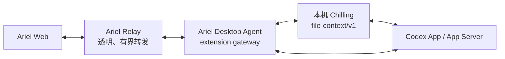

# 0089：Chilling 文件上下文前端与可选接入

> 后端归属已由 [0119](0119-self-contained-desktop-file-context.md) 取代：文件能力内置到 Ariel Desktop Agent，不再连接 Chilling。以下保留最初设计，既有用户行为与安全约束继续有效。

- 状态：Implemented（2026-10-17；用户已完成实际使用验收）
- Ariel 范围：Web UI、feature flag、能力发现、协议与透明转发、既有 Codex owner 发送。
- 后端归属：本机部署的 Chilling；详见 Chilling `docs/specs/0002-ariel-file-context-backend.md`。
- 不涉及：Ariel 读取本机文件、解析 Codex 私有文件接口、实现路径安全规则、持久化文件正文或在 Relay 上运行 Chilling。

## 1. 架构决定

文件内容与 Codex 文件协议属于本机后端能力，不放进 Ariel。Ariel 只提供用户界面及可选集成：



- 修改文件查询、文件读取、路径校验、选区校验和上下文序列化全部由 Chilling 实现。
- Ariel Desktop Agent 只把版本化 Ariel 请求映射到 Chilling 的本地 contract，不复制 Chilling 业务规则。
- 最终发送仍由 Ariel 已有的唯一 Codex owner 完成。Chilling 返回经过校验的 context envelope，但不另开 mutation owner、不直接启动 turn，避免 Ariel、Codex App 与 Chilling 三方竞争。
- Relay 可以短暂承载有界文件响应和选区，但不解析、不缓存、不写日志或持久化正文。
- Chilling 默认只通过用户权限保护的本机 Unix socket 提供该 contract，不要求暴露公网 HTTP。这样 `www.kan.chat` 的手机 Web 不需要直连 LAN 地址，也不受 mixed-content、CORS 或 Private Network Access 限制。

## 2. Feature flag 与能力协商

### Ariel flag

Relay／Web 与 Desktop Agent 使用同名布尔 flag：

```text
--enable-chilling-file-context
```

- 默认 `false`；支持显式 `--enable-chilling-file-context=false`。
- Relay／Web 关闭时不展示文件卡和内容页，不发 `file.context.*` 请求。
- Desktop Agent 关闭时不连接 Chilling、不探测 socket、不声明 capability。
- flag 是启动配置，首版不热切换；旧配置缺失视为关闭。
- 本地 Chilling endpoint 使用独立配置，例如 `--chilling-endpoint unix:///...`；不得硬编码用户名或固定 home 路径。

### 生效条件

Web 只有同时满足以下条件才开放交互：

1. Ariel Web feature flag 开启；
2. 目标设备在线；
3. Agent hello 声明 `chillingFileContext: true`；
4. Chilling handshake 返回兼容的 `file-context/v1` 且 ready。

任一条件不满足时保持现有会话体验，不显示失效按钮。flag 只允许能力被发现，不得把未运行或版本不兼容的 Chilling 冒充为 ready。

## 3. Ariel 公共协议

新增 capability：

```text
chillingFileContext: boolean
```

新增请求方法：

| 方法 | 用途 | 主要输入 |
| --- | --- | --- |
| `file.context.changes` | 批量读取当前已展示 turn 的修改文件 | `threadId`, `turnIds[]` |
| `file.context.read` | 按需打开一个已验证的修改文件 | `threadId`, `turnId`, `itemId`, `path`, 可选 revalidate metadata |

`file.context.changes` 是会话打开后的可选增强：单个 change 不在 thread 权威 cwd 内或无法安全归一化时，backend 省略该项；整批摘要失败时 Web 不展示全局错误，也不得把已经打开的会话降级。用户主动点击文件后的 `read`／`prepare` 错误仍明确展示。

现有 `turn.start`、queue 与 steer 输入增加可选 `fileContexts[]`，每项包含 Chilling 所需的引用来源、路径、行号、文件摘要和选中文本。Desktop Agent 先调用 Chilling 的 prepare；成功后只把 Chilling 返回的 canonical context envelope 交给现有 owner 发送。

协议限制：

- `turnIds[]` 最多 10 个；Web 首屏只请求现有最近 4 turn，不能随历史总量线性扩张。
- 单次 read 解码后最多 1 MiB。
- 每条消息最多 5 个选区；单个最多 8 KiB，总计最多 24 KiB。
- response、错误码和超时有界；Relay 继续使用原 request identity 与 Agent epoch fencing。
- Relay 和 Web 不接触 `fs/readFile`、App Server shape、Chilling socket 方法名或本机绝对路径。

## 4. Web 用户行为

### Turn 文件卡

1. completed turn 的 changes 查询返回非空后，在该 turn 回复区域末尾显示“修改的文件”。
2. 文件显示项目相对路径和新增／修改／删除类型；同一路径在同一 turn 内去重。
3. 默认展示前 5 项，其余按需展开。卡片请求失败只影响当前卡片，不替换整个会话为 loading。
4. 初始历史、增量 turn 完成和切回已缓存会话时只查询当前可见且尚无结果的 turn；不得每次 foreground 或切会话都重新查询全部 turn。
5. 删除文件可以查看 turn diff，但不能冒充当前文件仍存在。

### 文件内容页

- 点击文件才发 `file.context.read`；会话加载不预读正文。
- 桌面端使用侧边面板，手机端使用全屏页；返回后保留会话滚动位置、composer 草稿和附件。
- 内容页标明“当前工作区版本”，不能把当前文件称为该 turn 的历史快照。
- 等宽字体、稳定行号、横向滚动；长内容使用虚拟化或等价有界 DOM。
- 已有内存副本时可先显示并后台 revalidate，但发送引用前必须使用 Chilling 返回的 digest／metadata 校验。
- Web 只保留最多 10 个文件、总计 8 MiB 的内存 LRU；刷新、退出认证或设备 epoch 变化后清空，不写 IndexedDB／localStorage。

### 选区引用

- mouse、touch 和 keyboard 均能选择连续文本；空选区不创建附件。
- 点击“引用到对话”后在 composer 中增加 chip，不立即发送。
- chip 展示相对路径和 1-based 行号；删除只改变本地草稿。
- 选区内容、digest 或文件版本变化时，Chilling prepare 返回 `FILE_CHANGED`，Web 保留问题和引用并让用户显式刷新，不静默替换选区。
- 发送成功按现有 exact client-message 规则清空正文与引用；失败或 outcome unknown 均保留。
- 历史消息中的 canonical context 由 Ariel 投影为 quote chip；格式不合法时按普通文本显示，不吞用户正文。

## 5. Gateway 行为

Desktop Agent 的 extension gateway：

1. 只接受协议白名单中的 `file.context.*` 和 turn context prepare，不提供任意 URL、任意 Chilling method 或通用 HTTP tunnel。
2. 每个请求绑定 device、agent epoch、thread、request ID，并设置独立并发数、响应大小和 deadline。
3. 通过配置的 Unix socket 调用 Chilling；不自动启动、安装、升级或重启 Chilling。
4. handshake 失败、contract major 不兼容、socket 权限异常或 Chilling not-ready 时撤回 capability。
5. Chilling prepare 成功不等于 Codex 已受理；之后仍走 Ariel 0069 的 exact client-message 核对。
6. request 转发前后不记录正文、选区、绝对路径或 canonical envelope；日志只记录方法类别、耗时、大小和错误码。

Relay 仍按 Ariel v1 schema 校验固定方法和有界 payload；不得演变为用户可指定目标地址的 SSRF／本机代理入口。

## 6. 错误与降级

Web 至少识别：

- `FEATURE_DISABLED`
- `CHILLING_UNAVAILABLE`
- `CONTRACT_UNSUPPORTED`
- `FILE_NOT_FOUND`
- `PATH_NOT_ALLOWED`
- `UNSUPPORTED_FILE_TYPE`
- `FILE_TOO_LARGE`
- `FILE_CHANGED`
- `OUTCOME_UNKNOWN`

读取失败只显示在文件页；prepare 失败保留 composer；Agent 断线按现有设备恢复语义处理。Chilling 不可用不影响普通历史、订阅、发送、队列、审批、重命名或归档。

## 7. TDD 与验收

获批后严格按 red → green → refactor：

1. **Flag red**：默认关闭时 UI、Chilling connector、socket probe 和新增请求均零调用；开启但 capability 缺失仍隐藏入口。
2. **Protocol red**：schema 拒绝未知方法、超量 turns、超限选区、绝对路径响应和通用 proxy 参数；旧 Agent／Web 保持兼容。
3. **Gateway red**：fake Chilling 覆盖 handshake、版本不兼容、timeout、断线、过大响应、并发上限、epoch 变化与错误透传；证明没有任意 method／endpoint 转发。
4. **Web red**：文件卡、批量可见 turn 查询、按需 read、局部 loading、内容页返回、选区 chip、删除、多引用、发送成功清空和失败保留。
5. **缓存 red**：切应用、切会话再返回和 background revalidate 不重复全量 changes／read；device epoch 变化清缓存。
6. **跨仓 integration**：使用 fake Codex + 实际 Chilling fixture，验证 changes → read → selection → prepare → Ariel owner send；断言 Relay 无持久正文。
7. **真实浏览器**：桌面和 390×844 手机 viewport 覆盖 mouse／touch／keyboard 选区、横向滚动、返回状态和 composer；保存手机截图。物理 iPhone／Safari由用户复验。
8. 运行 Go 全量／race／vet、Web 全量、production build 和 Playwright；公网发布仍按“更新 Ariel”双端规则执行，但不会自动部署 Chilling。

## 8. 验收标准

- 默认关闭时 Ariel 行为与资源使用保持现状。
- 开启且本机 Chilling ready 时，最近 turn 的修改文件可打开、选择并引用到同一会话。
- Chilling 承担全部 Codex 文件和路径语义；Ariel 不出现第二份实现。
- 一个页面只使用既有多路复用 WebSocket；不会为每个 thread 或文件创建独立 socket。
- 文件正文只按需流经 Relay，不在 Relay 或 Web 持久化；Web 不获得本机绝对路径。
- Chilling 停止、版本不兼容或读取失败不会清空会话、草稿或现有正文。
