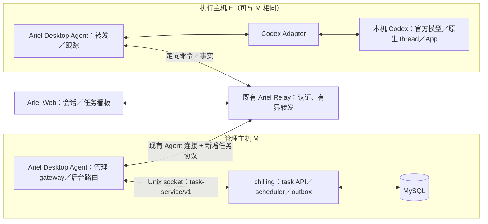

# 0091：Chilling 任务看板统一入口与后台路由

- 状态：Approved（2026-10-17：用户明确要求按已确认分工实现；TDD 与兼容性验收进行中，未部署）。
- Ariel 范围：Web 看板与导航、现有认证、能力发现、受限 task gateway、无浏览器时的跨主机任务路由，以及执行主机既有 Codex owner 的任务入口。
- chilling 范围：本地 MySQL、任务领域、反馈／进展／read-state、scheduler／outbox、降噪策略与 `task-service/v1` 本地 contract；详见 chilling `docs/specs/0001-local-task-kanban.md`。
- Single Source of Truth：chilling 是看板任务本体与唯一权威；Ariel 连接任务库和绑定执行主机，呈现任务视图与交互，不持有第二套任务领域或调度。原生会话／执行事实的权威仍是各执行主机的 Codex。
- 历史：不恢复 0088 的云端数据库／scheduler 方案；替代独立 chilling Web 和直连执行主机方案。0089／chilling 0002 的文件上下文功能仍独立，不扩大其只读权限。

> 2026-10-18 范围修订：用户要求将 Ariel Web 恢复为引入看板前的会话界面。Web 看板、导航和 task client 的撤回边界见 0097；0097 获批后将取代本文相应 Web 要求，后台 task gateway、跨主机路由及 chilling SSOT 边界继续有效。在 0097 确认前暂停继续实现本文的 Web 看板部分。

## 1. 用户结果与入口

用户继续访问同一个 Ariel Web、使用已有登录，在 workspace 中切换「会话／任务看板」，无需记忆第二个网址、登录另一套界面或让手机直连本地 LAN 服务。

1. 桌面与手机均有可见的模式切换；不能只放在手机连接后会隐藏的 masthead。手机主内容头部和导航抽屉保留一致入口。
2. 看板先选择「任务管理主机」及其任务库；只有一个获准任务库时可自动选择。新建／开始任务另外选择「执行主机」和该主机的工作目录，两者不要求相同。
3. 默认列为待办／进行中／等待中／待验收／已完成，提供新建、任务详情、反馈输入、有效进展和未读。状态、反馈投递和用户验收规则由 chilling 0001 定义，不在 Web 复制任务状态机。
4. 从任务详情可在 Ariel 切到绑定执行主机的同一 native thread；另须验证该 thread 在执行主机 Codex App 中可见并可继续。不能把切换管理设备解释为迁移任务或会话。
5. 返回会话／看板保留各自选择、滚动与草稿；未读以 chilling 持久水位为准，不沿用普通会话浏览器本地 unread 当作任务 read-state。
6. 管理主机离线显示「任务后端不可用」，不能显示成空看板；执行主机离线时仍显示管理库中的卡片与已确认进展，反馈可持久保存后等待投递，不自动换机。

首版 Web 已提供上述入口与基本操作；真实 native／物理手机的未验项仍独立列出，不以浏览器 fixture 替代。

## 2. 代码与部署分工

术语约定：本文 `Agent(M)`／`Agent(E)`、协议 `role=agent` 和 `agentEpoch` 均指 Ariel 自己的 **Ariel Desktop Agent** 及其连接，不指 Codex Agent。任务负责人是目标主机的 **Codex Agent／原生会话**；ahsir Agent 是按需协作者。云端 Relay 的接入对象始终是 Ariel Desktop Agent，再由本机进程经 Codex Adapter 转发到 Codex，不要求 Codex 直接实现 Ariel 协议或连接 Relay。

| 组件 | 代码归属 | 运行位置与责任 |
| --- | --- | --- |
| Web 看板、导航、task client | Ariel `web/` | 由既有 Relay／Web 发布，浏览器呈现 |
| 公共 task 协议、认证与有界转发 | Ariel | 既有 Relay；无任务数据库、scheduler 或持久队列 |
| 管理 gateway、后台命令获取与事实回传 | Ariel Desktop Agent | 管理主机 M，连接同机 chilling |
| native 执行、后台跟踪与原生事实 | Ariel Desktop Agent／现有 Adapter | 所选执行主机 E；沿用同一个 Codex mutation owner |
| task API、业务状态、MySQL、outbox、汇报策略 | chilling | 本地管理主机 M；不另建 Web 或公网入口 |

### 权威归属与连接层边界

- 看板任务模型、状态迁移、反馈投递／回应、进展发布、已读、调度和重试规则由 chilling 唯一定义。Ariel 调用其业务 API、展示提交后的投影，不因 UI／云端代码归 Ariel 而接管看板业务。
- 任务关联的执行主机／native thread 从 chilling 获取，Ariel 依此连接对应 Agent；普通会话当前设备、临时连接和 browser cache 不得反向成为任务绑定依据。
- native 消息／turn 与受理事实由 Codex 提供，关联回 chilling 后才成为任务记录与状态依据；Agent completed、Web 已打开卡片、Relay 已收帧分别不能自动替代任务验收、已读提交或反馈落库。
- chilling 不可达时，Ariel 不接管任务写入、调度和验收，不用缓存伪装保存成功；重连按 chilling 的版本／事件水位恢复。原会话的直接输入仍以 Codex 为准，相关事实回流 chilling；任务详情中的反馈必须先经 chilling 留档再投递。

Ariel 不读取 `CHILLING_MYSQL_DSN`，不建立数据库连接，不运行 schema migration。chilling 不读取 Relay token／Browser session／Passkey 凭据，也不另开一个 Codex mutation owner。本次只统一前端／云端代码及通道，不进行两个仓库的物理合并。

## 3. 两种请求链路

### Web 访问任务数据

`Web → Relay → Agent(M) → 同机 chilling → MySQL`，结果反向返回。

只有 MySQL 事务提交才能显示「已记录」。Web 请求超时或断线时保留草稿和稳定客户端提交键，先向同一任务库核对，不以新键重新提交。Web task subscription 来源于管理后端已持久化的任务事件；native stream 不能跳过落库直接伪装为已保存的任务回复。

### 无浏览器时继续工作

完整链路：`chilling → Ariel Desktop Agent(M) → Ariel Relay → Ariel Desktop Agent(E) → Codex Adapter → 本机 Codex 原生 owner/thread`。这里的后台 Agent↔Agent 路由发生在两个 Ariel Desktop Agent 之间，不是 Codex 直连云端，也不是 ahsir A2A。

1. chilling 保存带授权、task version 和执行绑定的 outbox command。
2. Agent(M) 经本地 contract 有界获取／lease command，通过新增任务后台消息交给 Relay，再定向送往 Agent(E)。不能让 Web 充当 scheduler 或借用浏览器 session 发起后台任务。
3. Agent(E) 核验管理来源、目标与本机授权，经既有 owner 提交；busy 延后，unknown 核对，不另开不在 App 可见的后端会话。
4. native 回执和后续事实先通过执行机出站发布策略，再按稳定身份经 Relay 返回 Agent(M)，提交 chilling 幂等落库；后台跟踪与浏览器的 thread subscription／暖保留无关。不能先传原文再让管理机过滤。
5. chilling 在落库后通知 Web task subscription；无人在线时只保留本地任务数据，不为每个任务创建云端常驻进程。
6. M 与 E 相同可走 Agent 内部本地通路优化，但授权、绑定核对、唯一 owner 与 native 受理语义不变；不能在 Relay 失联时暗中改由 chilling 直接启动 turn。

实施前 Relay 的 `agent` 连接只允许 response／event，请求由 `web` 发起，且 Agent event 只回相应 Web 订阅者。本轮新增了独立的后台 dispatch、return routing 与 tracking；0089 的 Unix socket file-context client 仍不承接反向调度。

## 4. 开关、角色与 readiness

1. Ariel Relay／Web、各 Desktop Agent 和 chilling 分别显式启用 `--enable-tasks`，默认 false；旧配置缺失视为关闭，一端开启不隐式开启其他端。
2. Relay／Web 关闭：隐藏看板入口、不注册 task 业务路由、不发送 task 查询／订阅、不建立后台任务路由；原会话与独立文件上下文保持原行为。
3. Agent 关闭：不连接 task contract、不获取 outbox、不创建后台任务跟踪、不声明任务能力；已有 file-context flag 不代表已开启任务。
4. Agent 的任务管理角色与执行角色分开。管理角色须本地 `task-service/v1` 兼容且 ready；执行角色须本机任务执行明确授权、Codex ready、官方模型及 native gate 通过。管理角色不应因 M 无可用 Codex 而被错误禁用。
5. capability 分别表达 task management、task execution 及版本／readiness，具体字段由获批 wire schema 固化。能力发现不授予执行权限；管理主机获准派发的目标设备范围须显式限定。
6. chilling 的任务开关关闭时不读取 DSN、Open／Ping／migration 均零调用；单独开启 0002 文件上下文仍可工作。Ariel 无论任务开关值如何均不读取 DSN、不连接 MySQL。
7. 断线或 task contract 不兼容只撤回相应任务能力；不重启／安装／升级 chilling、不清空已打开会话或草稿、不把任务故障变成整个 Ariel readiness 失败。

## 5. 协议、身份和授权边界

以下是消息类别，实施 wire contract 已固化在第 9 节、Ariel task schema 与 chilling `task-service/v1`，不能据类别表使用未定义的任意 proxy 方法。

| 类别 | 发起方 → 目标 | 输入与结果 |
| --- | --- | --- |
| task discovery／list／read／subscribe | Web → M | 任务库、分页／游标；返回有界任务视图／已持久事件 |
| task operation／feedback／read ack | Web → M | 稳定客户端键、task version、操作枚举／反馈／已见 seq；返回持久身份与状态 |
| task dispatch／reconcile | 获准 Agent(M) → Agent(E) | task store、command、task、attempt、绑定版本、目标及有界操作；返回明确拒绝／native 受理证据／unknown |
| task execution tracking／fact | Agent(E) → Agent(M) | 对应执行绑定、native 身份、来源水位；幂等提交、缺口／待核对，不冒充业务完成 |

不变量：

- 区分 `task_store_id`、`management_device_id`、`execution_host_id`、task／attempt／command／feedback ID、绑定版本、native thread／turn／item／client-message、RPC request ID 和 Agent epoch。相同 native ID 在不同设备不视为同一执行。
- 管理／执行设备身份来自服务端已认证连接与显式角色授权，不信任消息自报的来源。共享 Agent token、deviceId 或 capability 自声明不能单独作为跨设备派工授权；须在隔离安全测试中证明来源无法冒充、目标不可越权。无法证明则 gate 不通过。
- Web 用户经已有 Ariel 身份映射到 chilling 中稳定的获准用户，不能自报 user ID；scheduler 使用独立后台设备角色，不持有 Browser Cookie／Passkey session。
- 固定方法与操作白名单，不提供任意 URL、Chilling method、native RPC、shell 或通用 HTTP tunnel。chilling contract 只暴露业务任务操作，native 写入留在执行 Agent。
- 后台路由与普通会话 pending／订阅域隔离；旧 epoch、错误 origin／target、过期 lease／绑定、超限 payload／并发应明确拒绝。租约过期本身不能证明旧 native 未执行。
- Relay 不做业务重试或离线重放，不把“接收了帧”当作 native accepted 或 MySQL committed。任务可靠性由本地 outbox、稳定业务 ID 和 native 事实核对提供。
- 关闭／暂停／目标更新后，旧 command 不得因重连重新执行。执行 Agent 在实际提交前核验新鲜授权；管理后端不可达且无法核验时不启动新 turn，已受理 native 工作不因此取消。

## 6. 断线、降级和资源

1. 管理后端离线：看板读写不可用，Web 保留输入；普通会话仍可使用。执行机离线：管理任务仍可读取／保存反馈，command 等待原主机，不换机。
2. Relay／Agent 断线：停留在 pending／unknown 或待同步，不能补建 thread；恢复先向原执行绑定核对再推进。Relay 重启后不恢复自己的任务队列，因为其本来没有持久队列。
3. native 被受理后，即使 Web、Relay 或 M 离线，也可能继续运行。恢复按 native snapshot／来源水位补齐；历史不可恢复时展示缺口，不能伪造无损同步。
4. 执行机切换遵循 chilling 0001：显式操作、旧执行终态核实、新 attempt／thread；unknown 时拒绝换机，旧反馈与迟到回执不自动改投。
5. 沿用现有连接复用，不为每张卡或每个任务创建一条 WebSocket；后台 tracking 有单独有界集合，不受浏览器退出时自动释放普通 thread subscription 的规则误取消。
6. task API 分页、帧／事件大小、pending、后台 tracking、每主机并发和重试退避均有硬上限，不能放大现有普通会话帧预算或用无限缓存掩盖断线。具体数值随 wire schema 固化后才实现。

## 7. 数据与日志

Web 任务数据、反馈、命令和必要进展允许经过 Ariel 云端有界内存。云端无任务 MySQL、scheduler、摘要模型、持久 command／outbox，也不写任务正文、反馈、摘要或工具内容日志；技术日志只含类别、耗时、大小、脱敏身份与错误码。

DSN、Codex 认证、私人知识库原文和完整工具轨迹不因任务集成自动上传。原生完整会话仍在执行机，任务所需事实保存在管理机；用户按需进入原会话的既有数据路径不因此扩大。Web 任务视图仅使用有界内存缓存，不新增持久任务正文镜像。

任务包含 chilling 0001 第 11.1 节的 `publish_policy`，执行 Agent 是出站检查点：默认不序列化完整 transcript／工具／文件正文；私有或来源不明只发枚举状态、时间和不透明身份／水位。自由文本摘要仅可基于明确获准经 Ariel 转发的材料，混入私有来源不能靠模型改写“脱敏”后自动上送；来源无法证明时保留本机，仅汇报受限状态。策略缺失／无效时 fail closed，白名单／来源限制由代码验证，不声称通用 DLP 能识别所有秘密。Web 应说明主动提交的任务与反馈会经云端转发。

代码在同一 Ariel 项目不等于业务数据存云端。数据库与持续任务处理仍在本地，但转发流量和云端连接处理会增加资源消耗，不承诺零增量。

## 8. TDD 与验收 gate

用户已明确要求按本稿逻辑实现。按下文固定契约进入 red → green → refactor；安全边界与未知结果语义不因实现便利改变，新增范围仍另行评审，未通过真实 native gate 的能力不开放。

1. **默认关闭／独立开关**：Web 无入口、任务 API／socket probe／dispatch／tracking 零调用；Ariel 所有模式均无 DSN 读取或 DB 调用；任务关、文件上下文开仍正常。
2. **Web 入口**：会话／看板切换、管理与执行设备分离、建卡／反馈／状态／未读；管理离线不显示空库，执行离线不阻断已存任务，失败／unknown 保留草稿。
3. **管理 contract 与单一权威**：实际 chilling fixture 覆盖 handshake、版本不兼容、MySQL 故障、幂等反馈、read cursor、命令 lease、来源事件核对；task management readiness 不被本机 codexReady 错误控制。native completed 不在 Ariel 自动变成任务完成／已读，Web 切设备不改绑定；chilling 离线不启动替代任务写入／调度，恢复以 chilling 版本／事件为准。
4. **无浏览器跨主机**：M、E 分机 fixture，在所有 Web 断开后仍派工、回执和回写进展；Relay 连接对象是 Ariel Desktop Agent，由目标主机 Adapter 转发至 Codex，不存在 Codex 直连 Relay 的任务链路。Ariel Agent 在线而 Codex 未就绪时明确显示等待 Codex，不误标主机离线。M=E 也使用同一 owner。首建 thread／首发回执丢失、数据库／Relay／两端重启后不盲目补建或重复执行。
5. **安全与隔离**：伪造管理身份、普通 Web 冒充后台调度、非授权目标、旧 epoch／lease／绑定、重复 native ID、超量帧／pending、任意 proxy 参数均被拒绝，原会话行为不被改变。
6. **真实 native**：执行主机官方模型核验、同 thread App 可见与继续、用户手工输入竞争／busy／unknown；只对隔离 fixture 操作，未验证项明确 unverified。
7. **浏览器**：桌面与 390×844 手机 viewport 验证入口始终可达、列／详情、反馈输入和键盘、草稿、返回原会话及 unread ack；断言行为与几何并检查截图。物理 iPhone／Safari 另列用户复验，不以 Chromium 模拟冒充。
8. **资源与数据**：云端无任务持久数据／队列／内容日志、离线结果不无限缓存；私有来源 sentinel 不得出现在任何执行机出站任务帧／摘要／错误，未知来源与混源摘要 fail closed。Go／race／vet、Web 单元、production build 及隔离 Playwright 回归按改动风险运行。

目前 0089 只提供 file-context 的前后端参考，不算本规格的实现证据。发布／重启需用户明确要求；本文档更新不触发部署。

## 9. 本轮实现固定契约

Web 固定使用 `task.list/read/create/action/feedback/readAck` 六种方法与现有 `request(deviceId,method,params)` 封装；deviceId 是管理主机，不是任务执行主机。完整字段、状态、幂等、lease 与 native fact 契约见 chilling 0001 第 15 节；Ariel 不自行推演任务状态。

- runtime meta `ariel-enable-tasks` 和进程 `--enable-tasks` 默认 false。设备 capability 分别为 `taskManagement`、`taskExecution`、`taskExecutionAuthorized`、`taskTracking`，管理设备同时提供 `taskStoreId`。执行授权不等于 official readiness；只读恢复不要求获得新的 provider 写权限。manager-only 模式允许无 Codex 的管理主机接入，不声明 native ready。
- Web 活跃看板／详情每 5 秒通过同一个 WebSocket 有界查询作为逻辑订阅；离开／隐藏时停用，不新增 per-task socket，不依赖浏览器执行后台任务。
- 管理 Agent 通过 `GET /v1/tasks/capabilities` 和 `POST /v1/tasks/rpc` 的 Unix contract 获取本地命令、验证、写回。固定单用户 principal 为 `ariel-owner`，由受信 gateway 注入，不接收 Web 自报身份。
- Relay 的任务设备凭据使用本地私有配置，按 deviceId 绑定独立高熵 token、task store 管理范围与允许的执行目标。继续复用 hello.token，不在消息内另带凭据。普通共享 token 不得占用已注册任务设备 ID，也不取得后台任务角色。
- 后台使用独立 typed `task.dispatch`、`task.track`、`task.validate`、`task.validated`、`task.receipt`、`task.fact` 等受限消息完成派发、提交前授权核对和事实回流；origin／target 来自已认证 peer，不信任自报来源。Relay 只保留有界临时 dispatch 路由，不保存待执行任务。`task.capabilities` 允许数据库／本地服务恢复后在同一连接收窄／恢复 readiness，Relay 再按设备凭据裁剪，不能用自报 capability 扩权。
- 发布事实前先运行出站 gate；缺少明确来源授权时只允许枚举状态、稳定不透明身份／水位，不上传 transcript 或工具原文。不得把当前 fixture gate 当成真实兼容性证据。
- native 写入复用同一 Desktop Agent Service。官方 gate 通过只读 `account/read`、effective `config/read` 及绑定 thread provider 核验；配置未知／第三方 endpoint／不可核验时 fail closed。具体支持版本与实际通过范围必须写入测试报告。

### 首版的验收边界

Web 的逻辑订阅有界轮询；已经加载的页会一并刷新，最多 10 页／500 张卡。后台进展只提取 exact command turn 的枚举状态及白名单工具活动计数，默认同状态内容变化至多每 10 分钟发布，状态变化即时发布，不自动上传 assistant／工具正文。

真实 Codex 写入／App 可见与继续、终态 command 之后的手工新 turn 自动回流、来源授权下的成果摘要、Hetairoi 专用事件映射与执行主机换绑 UI 仍未完成或待验。运行配置通过 `cmd/relay`／`cmd/desktop-agent`，暂未扩展 `ariel.sh`／launchd 配置持久化；本轮未部署／重启既有实例。不能将本规格标为全部 Implemented。

以上是已有获批行为的实施契约；若实现需要扩大角色授权、额外云端持久化、换 provider 或绕过 owner，须重新评审，而非自动执行。

## 参考

- [0089 文件上下文集成](0089-turn-file-links-and-selection-context.md)：Web／gateway／本机 Chilling 的分工参考，不包含后台跨 Agent 路由。
- [0069 精确送达核对](0069-confirmed-send-clears-composer.md)、[0076 原生首 turn](0076-local-draft-first-turn-bootstrap.md)、[0086 controller 暖保留](0086-progressive-open-frame-hint-and-warm-controller.md)。
- 现有 `internal/relay/server.go` 的角色限制、设备路由与订阅事件范围，以及 `internal/chilling/client.go` 的 Unix socket contract，是本稿“新增能力”边界的源码依据。
